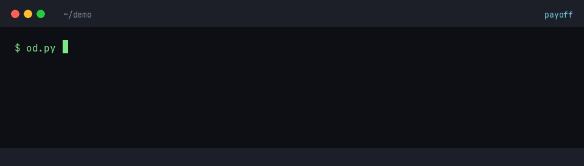

# open-design

<h3 align="center">The OpenDesign monorepo, including the pnpm trap that eats the first hour.</h3>

<p align="center">
  <a href="LICENSE"></a>
  
  
  
</p>

<p align="center">
  
</p>

## Install

One command for each agent — the skill is plain Markdown plus a script, so nothing is coupled to one ecosystem.

```bash
# Claude Code (plugin, stays updatable)
claude plugin marketplace add ibrahimbdr/appit-skills
claude plugin install open-design@appit-skills

# pi
pi install git:github.com/ibrahimbdr/open-design

# any agent that reads a skills directory
git clone git@github.com:ibrahimbdr/open-design.git
cp -r open-design/skills/open-design ~/.claude/skills/      # or ~/.codex/skills/, .cursor/skills/, …
```

## Why this exists

`AGENTS.md` is ~57 KB and the first hour usually goes to the corepack/pnpm version conflict or to inventing a dev command that does not exist (there is no root `pnpm dev`). This is the short version that actually starts the app.

## Use

- Health: `scripts/od.py doctor` — node, pnpm, ports, repo root`
- Start: `scripts/od.py start --web-port 17573`
- Screenshot: `scripts/od.py shot /tmp/od.png` — desktop via `tools-dev inspect`
- Pre-PR: `scripts/od.py checks`

## Requires

- Node `~24` (pinned in `.node-version`).
- pnpm **10.33.2** via Corepack — a global pnpm 11 shadows it and breaks `tools-dev`.
- `corepack pnpm install` once at the repo root.
- Docker only for containerized packing.

## What you get

- Points at `AGENTS.md` sections by heading instead of duplicating 57 KB.
- `start` waits for the port and dumps the last log lines when `tools-dev` exits early.
- `shot` refuses early when the desktop app is not running, instead of surfacing a sidecar ENOENT.

## Cost

| | tokens |
| --- | --- |
| always-on (the description, every session) | ~102 |
| on invoke | ~1k |

The demo above is regenerated from a real run: `demos/open-design.json` holds the captured
output, `tools/make_demo.py` renders it. No invented screenshots.

## Security

Static analysis with SkillSpector: **0/100, SAFE, 0 open findings** against the committed
baseline. Every accepted finding is listed with its reason in [SECURITY.md](SECURITY.md).
The skill never uses `shell=True`, never reads or stores a credential, and never chooses a
network destination at runtime.

## Part of the Appit collection

Browser QA · CI triage · Postgres · runbooks · SSH · Trello · cloud browsers · OpenDesign · Blender —
one marketplace: [appit-skills](https://github.com/ibrahimbdr/appit-skills).

## License

MIT. See [LICENSE](LICENSE).
